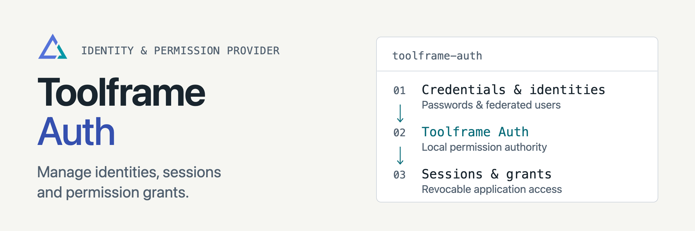

<p align="center">
<picture>
  <source media="(prefers-color-scheme: dark)" srcset="docs/assets/readme-banner-dark.png">
  <source media="(prefers-color-scheme: light)" srcset="docs/assets/readme-banner-light.png">
  
</picture>
</p>

# Toolframe Auth

[](https://github.com/toolframe/toolframe-auth/actions/workflows/ci.yml?query=branch%3Amain)

Manage access passwords, browser sessions, federated users and agent grants.
Auth owns identity and permission records; Core enforces access at each entrance.

## Quick start

In a running [Toolframe application](https://github.com/toolframe/toolframe-core#readme) with an active SQL provider:

```sh
toolframe --home APP plugin add pypi:toolframe-auth==0.3.2 --enable
```

Install [Dashboard Auth](https://github.com/toolframe/toolframe-dashboard-auth)
for login and access-management pages. The Entry Register recipe includes both.
Use Python 3.14+ and SDK 0.4+.

**Recovery:** retain the managed auth store and private keys together. Existing
v1 stores need an explicit migration before federated users and grants can be used.
Removing or reloading Auth retains its data.

**Access:** Dashboard, MCP and public HTTP methods have separate policies.
Choose closed failure behavior before exposing a protected application; see
[Core authentication](https://github.com/toolframe/toolframe-core/blob/main/docs/authentication.md).

## Guides

| I want to… | Start here |
| --- | --- |
| Manage passwords, users and grants | [Administration](docs/administration.md) |
| Add federated sign-in | [OIDC Auth](https://github.com/toolframe/toolframe-oidc-auth) |
| Use PostgreSQL | [Storage requirements](docs/administration.md#postgresql-storage) |
| Contribute or run checks | [Contributing](CONTRIBUTING.md) · [Verification](docs/ci.md) |
| Publish a package | [Releasing](docs/releasing.md) |

[Releases](https://github.com/toolframe/toolframe-auth/releases)

## License

[Apache 2.0](LICENSE), with [NOTICE](NOTICE).
